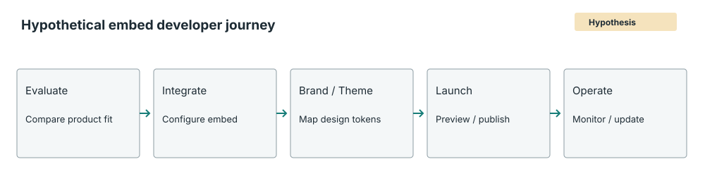

# Embed Developer Journey

Every stage below is a hypothesis for a hypothetical persona, not a finding from an interview. No interviews were conducted.

| Stage | Hypothesized job | Open validation question |
|---|---|---|
| Evaluate | Decide whether the embedded analytics integration fits the product and operating constraints | Which evaluation criteria determine adoption? |
| Integrate | Configure the SDK and connect it to a host application | What integration steps create the most friction? |
| Brand / Theme | Align embedded content with existing design tokens | Which tokens and visual surfaces matter most? |
| Launch | Preview, validate, and publish the embedded experience | What release checks and approvals are required? |
| Operate | Monitor failures and maintain consistency as the host product changes | How are theme regressions discovered and rolled back? |

