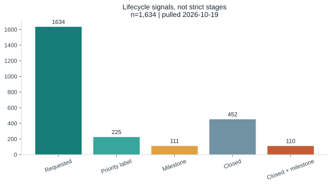
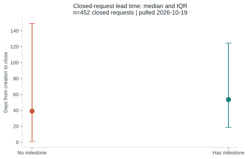

# Findings

Independent analysis of public information; values below are transcribed from `data/processed/*.csv`, pulled 2026-10-19. They are public issue signals, not customer or internal product metrics.

## Backlog and lifecycle

The fetched dataset contains **1,634** feature requests; **1,182** are open. The open share is 72.3% (= 100% - 27.7% closed). Priority labels appear on **13.8%**, and milestones on **6.8%**. There are **110** closed requests with a milestone. These are lifecycle signals; closed does not mean shipped.

## Demand concentration

**64.2%** of requests have zero 👍. The top 10% of requests account for **67.8%** of 👍, while the top 1% account for **18.9%**. This is a concentration among people who react, not a measure of the customer population.

## Demand by area

Administration has the most labeled requests in the qualifying area table (**289**) and the largest total 👍 (**330**). Metabot-labeled requests have mean 👍 **3.09**, compared with **0.99** among other requests (`ai_area_demand.csv`). Area labels may overlap; Metabot labels are only a proxy for AI-related requests.

## AI trend

Metabot-labeled share is **1.1%** in Oct24-Sep25 and **10.8%** in Oct25-onwards. The share may reflect a change in labeling practice, not solely a change in demand.

## Delivery context

The npm data includes stable minor lines from **0.51** onward; the median interval between first stable versions is **56 days**. This is published-version cadence, not a commitment or internal release schedule. Monthly merged-PR counts have a median of **952**; they include bots and backports and are not velocity.

## Hypotheses

| ID | Verdict | Evidence and limitation |
|---|---|---|
| H1 | Supported | Top 10% hold 67.8% of 👍 and 64.2% have zero 👍; vocal-user proxy only. |
| H2 | Supported | Metabot-labeled mean is 3.09 👍 versus 0.99 for other requests; labels are an imperfect and potentially changing area proxy. |
| H3 | Not supported | Milestone proportions are 6.8%, 5.4%, 10.1%, and 7.9% across buckets `0`, `1-2`, `3-9`, `10+`; small high-demand group and non-monotonic pattern. |
| H4 | Not supported | Priority proportions are 17.0%, 8.5%, 6.3%, and 10.5%; not a monotonic relationship. Labels are incomplete planning evidence. |
| H5 | Supported (association only) | Closed requests with a milestone have median close time 53.5 days versus 39.0 without; observational association, not causal evidence. |

## Reference-figure differences

The processed dataset has **1,634** requests versus the supplied manual reference **1,632**. The top-decile share is **67.8%** versus about **68%**; zero-👍 share is **64.2%** versus about **64%**; priority labels are **13.8%** versus **13.7%**. Milestone share is **6.8%**, consistent with the reference. The processed overall median close time is **43 days**; the milestone-group medians are **53.5** and **39.0 days**. The data contains **110** closed-with-milestone requests, consistent with the reference. AI shares are **1.1%** and **10.8%**, close to the reference range. These observed outputs supersede the manual reference.

## Limitations

This is a public issue snapshot; 👍 is a vocal-user proxy, milestones are not proof of shipping, labels can shift, area totals overlap, and merged PRs are not velocity. Public data does not provide feature usage, customer outcomes, actual sprint performance, revenue, or internal product strategy.