<p align="center">
  <h1 align="center">Demand-Driven Roadmap for a B2B Analytics SaaS</h1>
  <p align="center">An independent public-data product case study for an Associate Product Manager portfolio</p>
</p>

**Independent analysis of public information; not affiliated with or endorsed by Metabase.**

The MIT license in this repository applies to the original code only; it does not relicense upstream public data or third-party materials.


## Figma Prototype

[Open the interactive prototype in Figma](https://www.figma.com/make/swJ01JCNIAL5jhVVEvRU6B/Low-Fidelity-Wireframe-Prototype?t=44nNTokPUmXkINYR-1)

**Proposed design:** these prototype screens are illustrative UI, not a shipped product or evidence of SDK capabilities. Any sample workspace details and values shown in the images are not case-study findings.

<p align="center">
  <a href="https://www.figma.com/make/swJ01JCNIAL5jhVVEvRU6B/Low-Fidelity-Wireframe-Prototype?t=44nNTokPUmXkINYR-1">
    
  </a>
</p>

<p align="center">
  
  
</p>

> **Thirty-second summary:** A public issue dataset pulled 2026-10-19 contains **1,634** feature requests, of which **1,182** are open. The top 10% hold **67.8%** of positive reactions, while **64.2%** have none. A proposed SDK theming initiative ranks first under stated RICE assumptions, but the lead over the next initiative is narrow and sensitivity can change the order. No internal product data, customer interviews, or delivery results are claimed.

## Hiring-Manager Map

| JD line | Proof | Link |
|---|---|---|
| J1 Strategy and prioritization | Public issue analysis, RICE, roadmap | [Strategy](03-strategy/strategy-one-pager.md) |
| J2 Product analytics | Processed findings and metrics plan | [Findings](02-analysis/findings.md) |
| J3 SQL and technical specs | DuckDB analysis and acceptance criteria | [SQL](scripts/analysis.sql) · [PRD](04-prd/PRD-embedding-sdk-theming.md) |
| J4 PRDs | Draft v0.1 PRD | [PRD](04-prd/PRD-embedding-sdk-theming.md) |
| J5 Cross-functional collaboration | Proposed RACI and communications | [RACI](07-stakeholders/raci.md) |
| J6 Roadmap and success metrics | Proposed roadmap and metrics plan | [Roadmap](03-strategy/roadmap.md) |
| J7 Market/user evidence | Public data and limited competitor facts | [Research](01-research/competitor-landscape.md) |
| J8 Agile and release quality | Planned sprints plus observed public release context | [Delivery plan](06-delivery/sprint-plan.md) |
| J9 B2B SaaS lifecycle | Hypothetical embed journey and lifecycle caveats | [Journey](01-research/user-journey.md) |

## Key Findings

| Signal | Result | Interpretation |
|---|---:|---|
| Feature requests in snapshot | 1,634 | Public requests, not customers |
| Open requests | 1,182 | Open state is not a delivery commitment |
| Requests with zero positive reactions | 64.2% | Vocal-user proxy only |
| Positive reactions held by top 10% | 67.8% | Demand signal is concentrated |
| Requests with a milestone | 6.8% | Planning proxy only; not proof of shipping |
| Median close time, milestone vs no milestone | 53.5 vs 39.0 days | Association among closed issues only |
| Metabot-labeled share, earlier vs later period | 1.1% vs 10.8% | Labeling practice may have changed |

All figures above are read from `data/processed/`; regenerate with the commands below. `👍` measures reactions from vocal public users, not customers or total demand.

<details>
<summary>Charts and hypothesis verdicts</summary>

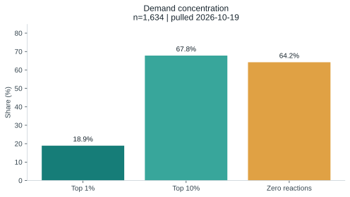

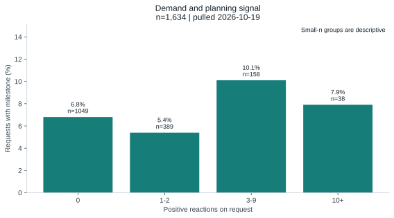

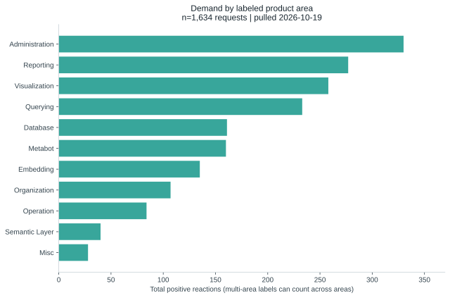

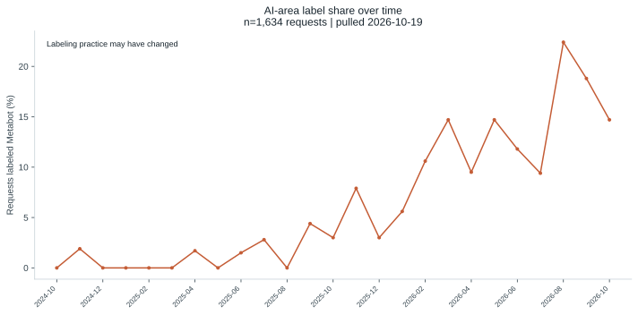

| Hypothesis | Verdict |
|---|---|
| Demand is concentrated in a few requests | Supported |
| AI-area requests attract more demand per request | Supported; label proxy and changing practice limit confidence |
| More demand means more likely to receive a milestone | Not supported; non-monotonic pattern and small high-demand group |
| Priority labels follow demand | Not supported; non-monotonic pattern |
| Milestone requests take longer to close | Supported as association only |

See [full findings and limitations](02-analysis/findings.md).
</details>

## Strategy and RICE

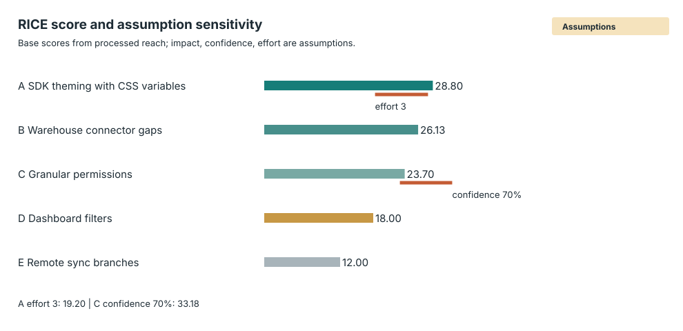

Initiative A leads the base calculation; the score difference is narrow, and changing confidence or effort assumptions can change the order. Reach is the sum of 👍 on qualifying open issues; Impact, Confidence, and Effort are assumptions. See [ranked scores and sensitivity cases](03-strategy/rice.md) and [proposed roadmap](03-strategy/roadmap.md).

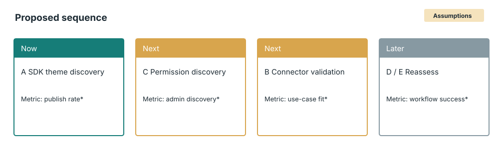

## Competitor Context

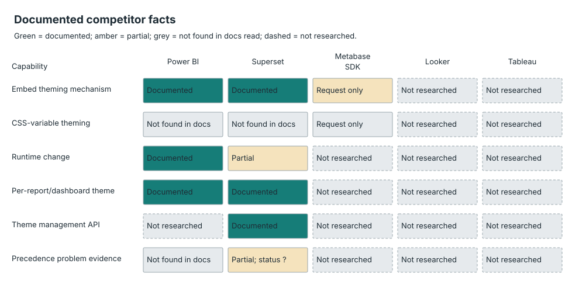

Facts are restricted to the sources documented in the [competitor landscape](01-research/competitor-landscape.md). “Not found in docs read” is not proof that a feature does not exist. Looker and Tableau are not researched.

## PRD and Proposed Design

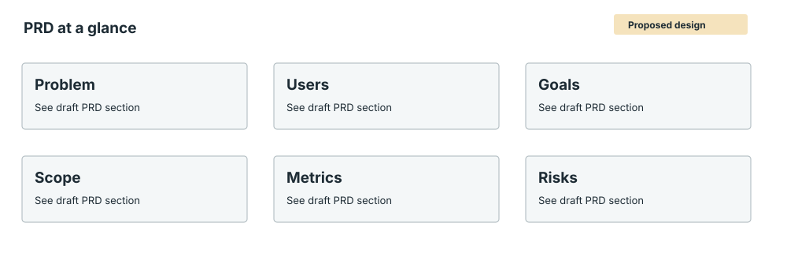

Draft: [Embedding SDK theming with CSS variables](04-prd/PRD-embedding-sdk-theming.md). Proposed design only; no product capability is asserted.

| Proposed wireframe | View |
|---|---|
| Configuration | 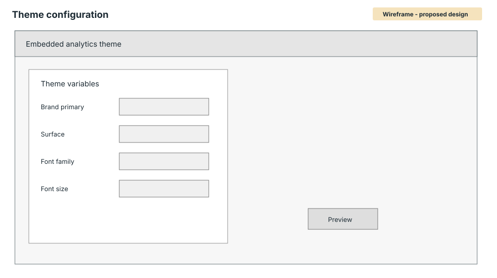 |
| Preview | 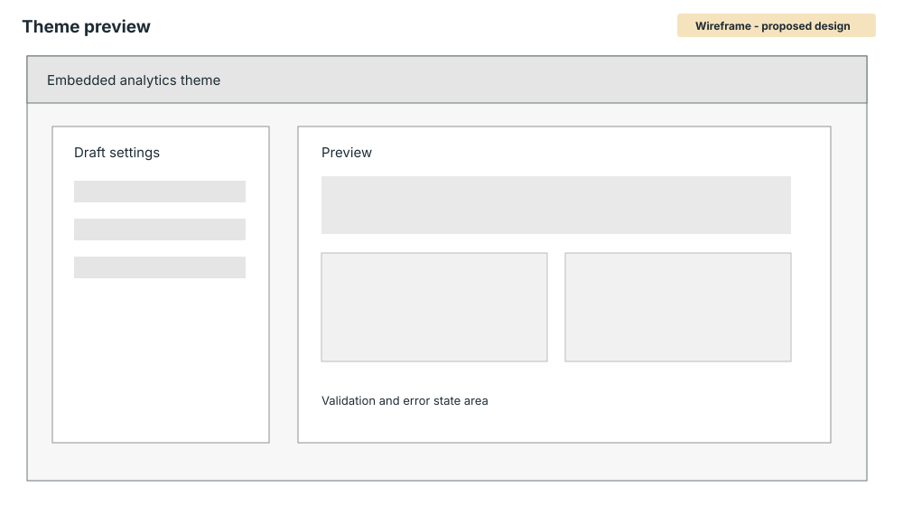 |
| Publish | 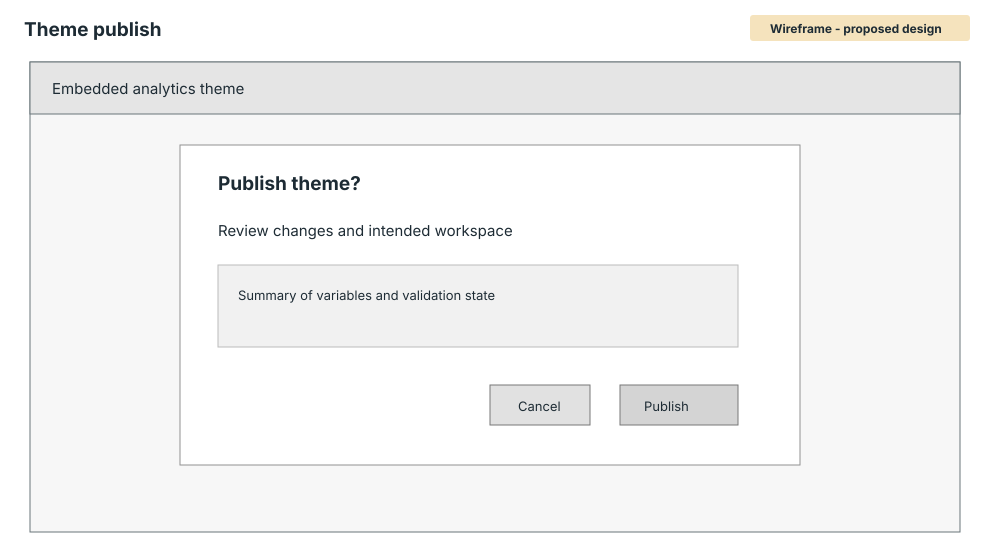 |

## Delivery Context

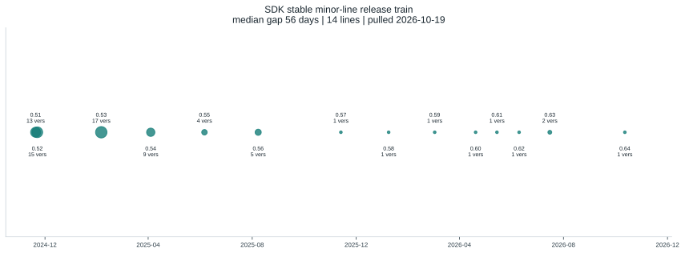

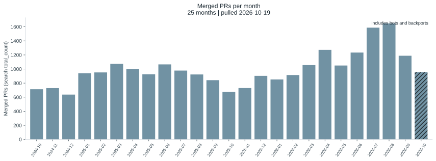

The npm release train is published-version context. Merged-PR counts include bots and backports and are not velocity. Delivery artifacts are **planned, not executed**: [backlog](06-delivery/backlog.csv), [sprint plan](06-delivery/sprint-plan.md), [release plan](06-delivery/release-plan.md), and [metrics plan](05-metrics/metrics-plan.md).

## Method

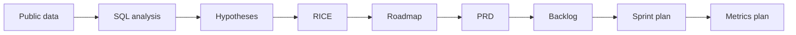

<details>
<summary>Visual index</summary>

| SVG | What it shows | Label |
|---|---|---|
| [demand-concentration.svg](assets/demand-concentration.svg) | Public issue reaction concentration | Real data |
| [demand-vs-planning.svg](assets/demand-vs-planning.svg) | Reactions versus milestone signal | Real data |
| [area-demand.svg](assets/area-demand.svg) | Reactions by labeled product area | Real data |
| [ai-share-trend.svg](assets/ai-share-trend.svg) | Metabot label share over time | Real data |
| [lifecycle-signals.svg](assets/lifecycle-signals.svg) | Public lifecycle signals | Real data |
| [lead-time.svg](assets/lead-time.svg) | Closed-request lead-time distribution | Real data |
| [sdk-release-train.svg](assets/sdk-release-train.svg) | Published SDK minor lines | Real data |
| [merged-prs-monthly.svg](assets/merged-prs-monthly.svg) | Monthly merged-PR search totals | Real data |
| [competitor-matrix.svg](assets/competitor-matrix.svg) | Documented and unresearched competitor facts | Real data / Not researched |
| [embed-journey.svg](assets/embed-journey.svg) | Hypothetical developer journey | Hypothesis |
| [rice-scores.svg](assets/rice-scores.svg) | Scores and sensitivity scenarios | Assumption |
| [roadmap.svg](assets/roadmap.svg) | Now / Next / Later sequence | Assumption |
| [prd-at-a-glance.svg](assets/prd-at-a-glance.svg) | PRD summary | Proposed design |
| [wireframe-theming-1-config.svg](assets/wireframe-theming-1-config.svg) | Configuration wireframe | Proposed design |
| [wireframe-theming-2-preview.svg](assets/wireframe-theming-2-preview.svg) | Preview wireframe | Proposed design |
| [wireframe-theming-3-publish.svg](assets/wireframe-theming-3-publish.svg) | Publish wireframe | Proposed design |

</details>

## Reproduce

Python 3.9 or later is expected. Create a local `.env` containing `GITHUB_TOKEN=<your token>`; `.env` is ignored and must never be committed. Do not paste the credential into chat. You may instead export it directly in your shell.

1. Install: `.venv/bin/python -m pip install -r requirements.txt`
2. Load the local token and fetch the four required request windows:

   ```sh
   set -a; source .env; set +a
   .venv/bin/python scripts/fetch_requests.py 2024-10-01 2025-03-31
   .venv/bin/python scripts/fetch_requests.py 2025-04-01 2025-09-30
   .venv/bin/python scripts/fetch_requests.py 2025-10-01 2026-03-31
   .venv/bin/python scripts/fetch_requests.py 2026-04-01 2026-10-19
   ```
3. Fetch merged PR aggregates: `.venv/bin/python scripts/fetch_pr_counts.py`
4. Fetch npm versions: `.venv/bin/python scripts/fetch_npm_releases.py`
5. Analyze and rank: `.venv/bin/python scripts/run_analysis.py && .venv/bin/python scripts/rice.py && .venv/bin/python scripts/write_feedback.py && .venv/bin/python scripts/update_report_numbers.py`
6. Regenerate visuals and checks: `.venv/bin/python scripts/make_charts.py && .venv/bin/python scripts/make_portfolio_svgs.py && .venv/bin/python -m pytest -q && .venv/bin/python scripts/check_consistency.py`

The download-count API was not pulled; see [data sources](01-research/data-sources.md) for the manual option. Raw issue data stays under ignored `data/raw/`; do not commit it.

## Limits

- Public 👍 is a vocal-user proxy, not customer demand.
- Closed does not mean shipped; milestone is only a shipped proxy.
- Labels may change and requests may have multiple product areas.
- Merged PRs include bots/backports and are not velocity.
- No customer interviews, Jira board, feature usage, revenue, or internal strategy data is available here.

## About

- Name: [Your name]
- Role: [Role]
- LinkedIn: [LinkedIn]
- CV: [CV link]
- Email: [Email]

## Sources

- [GitHub feature requests and PR aggregates](01-research/data-sources.md)
- [npm SDK publish timestamps](01-research/data-sources.md)
- [Competitor source list](01-research/competitor-landscape.md)
- [Full method and limits](01-research/method-and-limits.md)